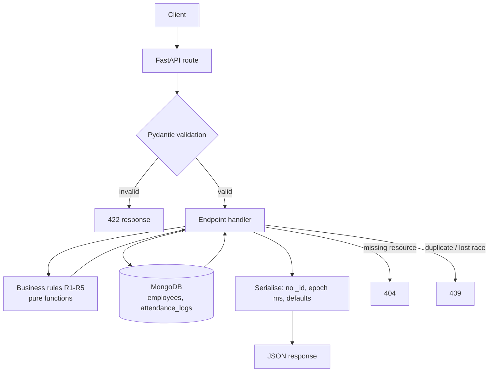
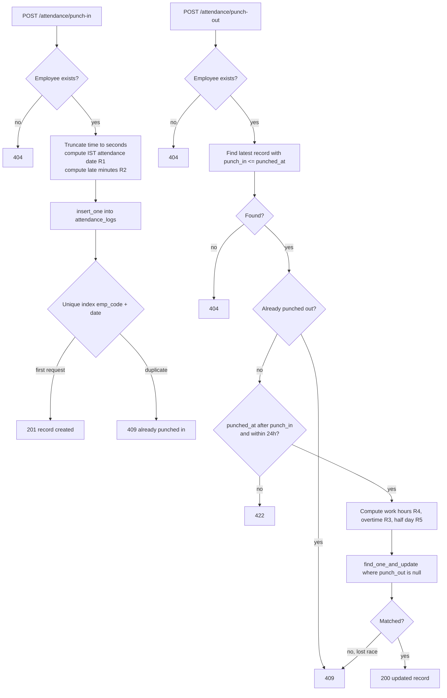
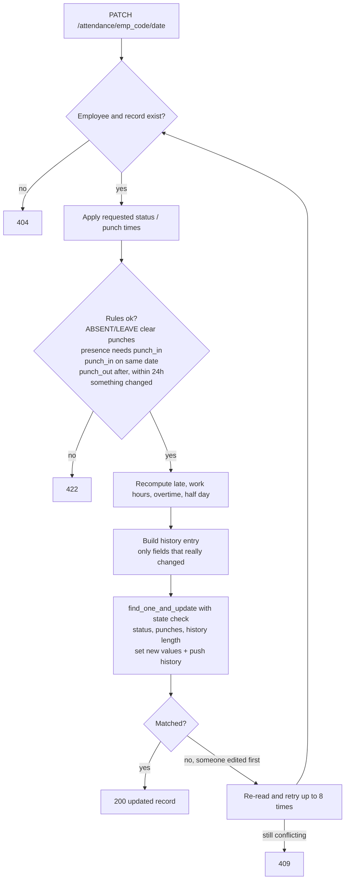
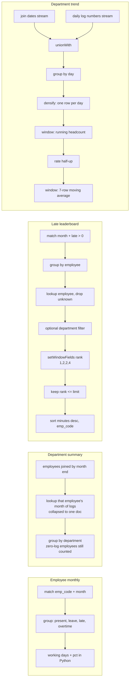
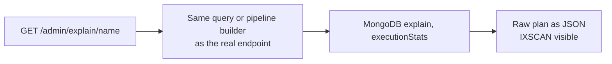

# Employee Attendance & Analytics API

A FastAPI + MongoDB service for employee punch-in / punch-out, manual corrections with an audit trail, and analytics built on MongoDB aggregation pipelines.

All application code is in a single file: `app/main.py`.

## Repository contents

| File | Purpose |
|---|---|
| `app/main.py` | The whole application |
| `requirements.txt` | Python dependencies |
| `REVIEW.md` | Part A: defects found in the starter code and how each was fixed |
| `DECISIONS.md` | Part C: answers to the five design questions |
| `README.md` | This file |

## Requirements
- Python 3.11+
- MongoDB 6.0 or newer (needed for `$densify`, `$setWindowFields`, `$rank`)

## How to run
```bash
python -m venv .venv
source .venv/bin/activate            # Windows: .venv\Scripts\activate
pip install -r requirements.txt

export MONGO_URI="mongodb://localhost:27017"
export MONGO_DB="attendance_db"

uvicorn app.main:app --port 8000
```
- `MONGO_URI` and `MONGO_DB` are read from environment variables (a local `.env` is also loaded; real environment variables take priority). Nothing is hard-coded.
- All indexes are created automatically at startup, and creating them again is safe.
- `GET /health` returns 200 only if MongoDB answers, otherwise 503.
- Interactive docs: http://localhost:8000/docs
- Quick local MongoDB: `docker run -p 27017:27017 mongo:7`

## Endpoints implemented

| Method | Path | Notes |
|---|---|---|
| GET | `/health` | 200 / 503 |
| POST | `/employees` | 201, 409 duplicate `emp_code`, 422 invalid |
| GET | `/employees` | filter by department, paginated, sorted by `emp_code` |
| POST | `/attendance/punch-in` | R1, R2; race-safe |
| POST | `/attendance/punch-out` | R3, R4, R5; works across midnight; race-safe |
| GET | `/attendance` | filters, pagination, sorted `date` desc then `emp_code` asc |
| PATCH | `/attendance/{emp_code}/{date}` | recomputes derived fields, appends to `history` |
| GET | `/analytics/employees/{emp_code}/monthly` | aggregation |
| GET | `/analytics/departments/summary` | aggregation across both collections |
| GET | `/analytics/leaderboard/late` | `$rank`, ties share a rank |
| GET | `/analytics/departments/{department}/trend` | `$densify` + moving average |
| GET | `/admin/explain/{endpoint}` | MongoDB `explain` (executionStats) |

## How it works (short)
- **Time:** instants are stored as UTC BSON dates and exchanged as epoch milliseconds. Dates, months and shift times are IST strings. PyMongo runs with `tz_aware=True`, so there are no naive datetimes.
- **Business rules R1-R5** are pure functions at the top of `main.py`; one function (`derive_fields`) decides every stored derived value for punch-in, punch-out and PATCH.
- **Concurrency:** duplicates are prevented by unique indexes (`emp_code`; `emp_code + date`), not by check-then-insert. Punch-out uses a compare-and-set update. PATCH uses optimistic concurrency with retry, so history entries are never lost.
- **Analytics** read the stored derived values and are single aggregation pipelines. Department summary starts from `employees` so people with no logs are counted. The leaderboard ranks with `$rank` before applying `limit`. The trend uses `$densify` for gap-filling and a window function for the 7-day average.
- **Rounding:** half-up using integers or `Decimal`, never float `round()`.
- **Explain:** each explain branch calls the same query/pipeline builder as the real endpoint.

## How it works (flow charts)

### Overall request flow


### Punch-in and punch-out


### Regularization (PATCH) with audit trail


### Analytics pipelines


### Explain endpoint


## Indexes (created at startup)

| Collection | Index | Used for |
|---|---|---|
| employees | `emp_code` (unique) | identity, 409, sort, joins |
| employees | `department, emp_code` | filtered employee list |
| employees | `department, joined_on` | headcount / trend per department |
| employees | `joined_on` | headcount across departments |
| attendance_logs | `emp_code, date` (unique) | one record per day, per-employee queries |
| attendance_logs | `date desc, emp_code` | list order, month ranges |
| attendance_logs | `status, date desc, emp_code` | list filtered by status |
| attendance_logs | `emp_code, punch_in desc` | finding the open record at punch-out |

## Work completed
- **Part A (review):** every defect found in the starter code is listed in `REVIEW.md` with where it was, how to notice it, and the fix. All fixes are in `app/main.py`.
- **Part B (build):** every endpoint in the contract is implemented, including the three aggregation pipelines (department summary, late leaderboard, department trend), punch-out across midnight, and regularization with an audit trail.
- **Part C (prove and explain):** `GET /admin/explain/{endpoint}` covers all five endpoint names and builds each query exactly as the real endpoint does. The five design answers are in `DECISIONS.md`.
